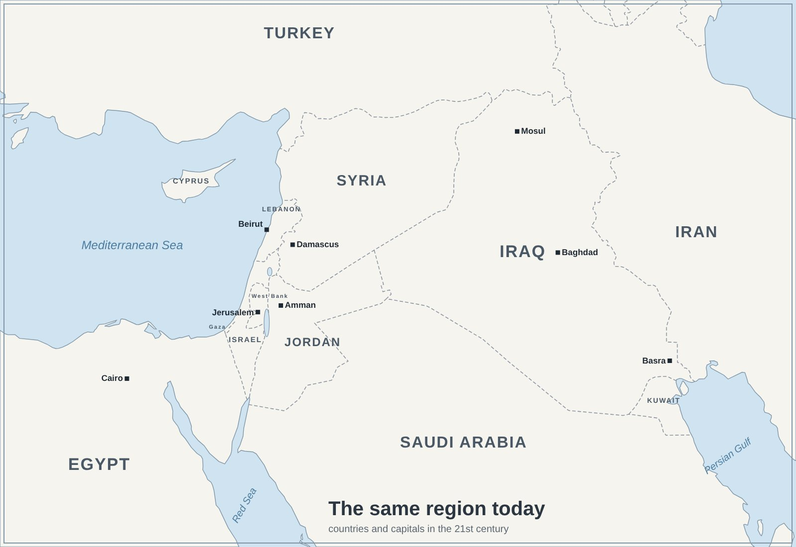
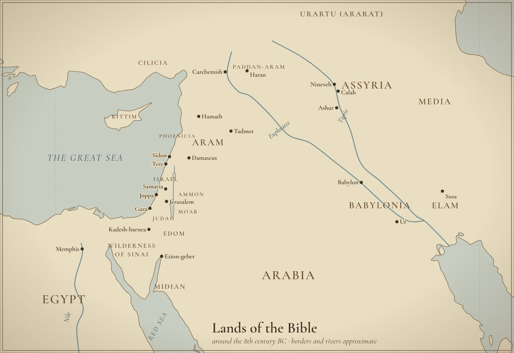
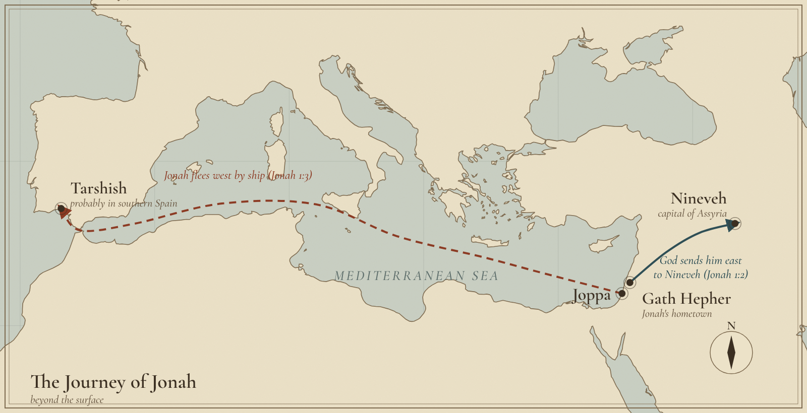
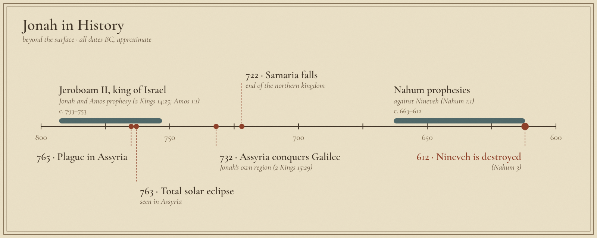

# Maps

## Then and now

Many places in the Bible still exist, but most of them have different names today. Drag the slider to compare the lands of the Bible with the same region today.

Bible timesToday
‹ ›
<input class="compare-range" type="range" min="0" max="100" value="50" aria-label="Slide between the map of Bible times and the map of today">

A few examples: **Aram** is today's **Syria** (its capital Damascus is still the capital). **Assyria**, with its capital Nineveh, lies in the north of **Iraq**, near the city of **Mosul**. **Babylonia** is southern **Iraq**. **Elam** and **Media** are in today's **Iran**. **Kittim** is **Cyprus**, and **Phoenicia**, with the city of Tyre, is today's **Lebanon**.

## The journey of Jonah

From the study [Jonah: Running from a Merciful God](/studies/the-book-of-jonah/).

## Jonah in history

*Ancient borders, rivers and dates on these maps are approximate.*
