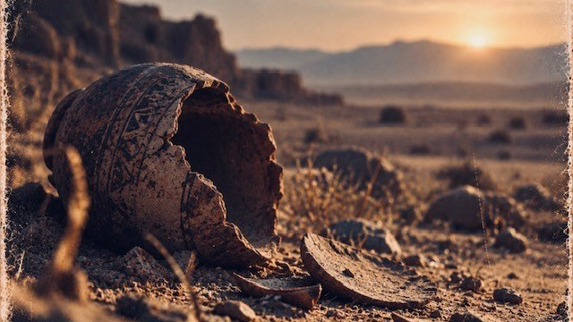
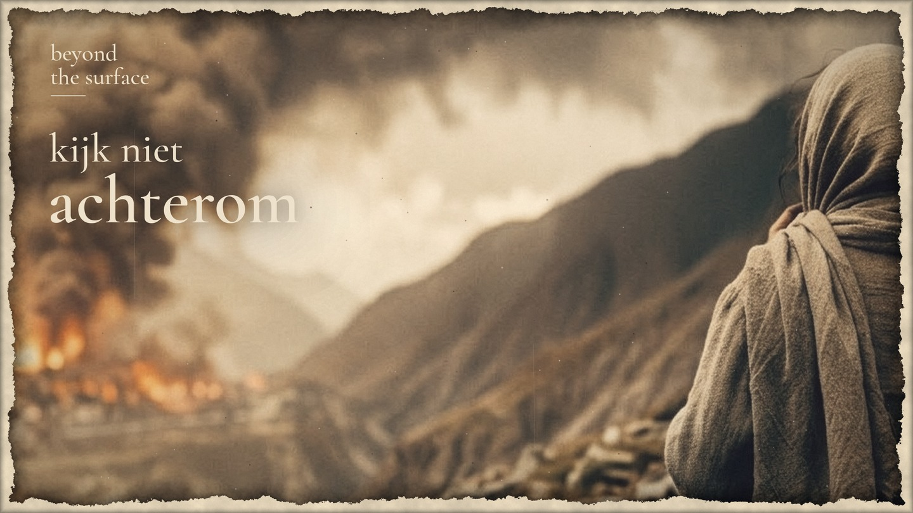
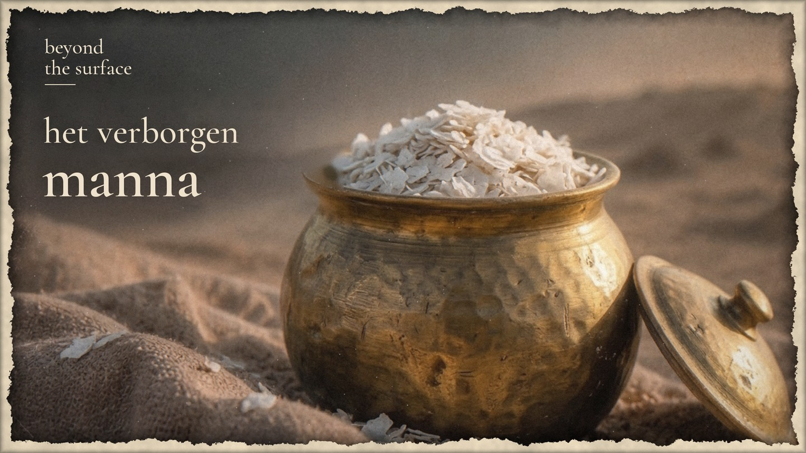

# Reading Plans

Some of the studies are also available as reading plans in the YouVersion Bible App, so you can read them day by day on your phone, on your own or together with friends.

[See all plans by Beyond the Surface in the Bible App →](https://www.bible.com/nl/organizations/a25773d0-84ae-4698-b7bc-ec6a4838bd63)

## De strijd van Jona

*11 days · in Dutch*

Many of us have known the story of Jonah since childhood. But this short book is far richer and more layered than it seems. This plan looks beyond the surface at the cultural and historical background of Jonah, traces hidden connections between the Old and New Testaments, and reflects on a God who is both merciful and just.

<a class="btn" href="https://www.bible.com/nl/reading-plans/80417-de-strijd-van-jona">Start this plan in the Bible App</a>

Prefer to read it in English? The full study is here on the site: [Jonah: Running from a Merciful God](/studies/the-book-of-jonah/).

## Het lijden van Job

*12 days · in Dutch*

Have you ever wondered where God is when life turns out differently than you hoped? This plan follows Job, a man who loses almost everything he holds dear and yet keeps seeking God. Through his intense conversations with his friends and his dialogue with God Himself, it asks questions that are still just as real today, and discovers that God can be near even when we don't understand Him.

<a class="btn" href="https://www.bible.com/nl/reading-plans/79524-het-lijden-van-job">Start this plan in the Bible App</a>

Prefer to read it in English? The full study is here on the site: [Job: Where Is God When Everything Falls Apart?](/studies/the-book-of-job/).

## Don't Look Back

Lot's wife looked back, and Jesus tells us to remember her. A plan about where our hearts are, what we hold on to, and why we were made for a heavenly home.

*Coming soon to the Bible App.*

## The Hidden Manna

*Coming soon to the Bible App.*
